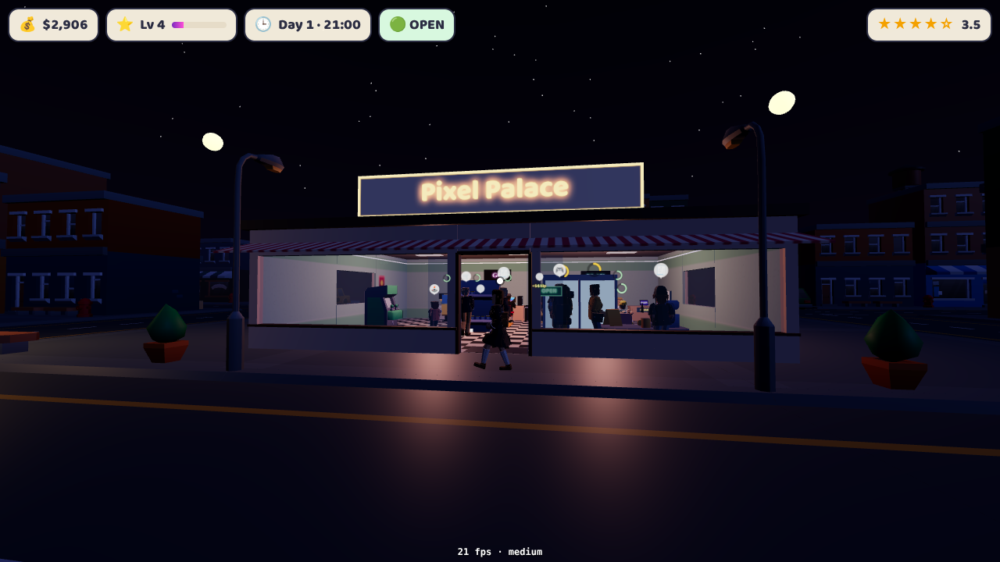
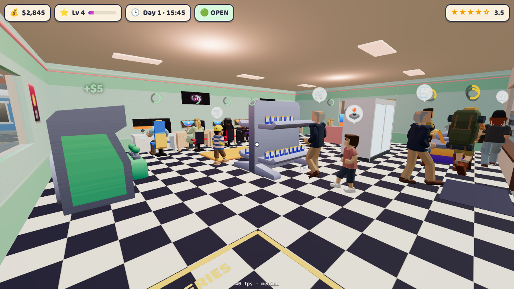

# Game Store Together

A cozy, low-poly, first-person **gaming-shop management game** you can run alone or with up to 3 friends.
Rent out gaming PCs and consoles, stock snacks and merch, run the checkout, hire staff, keep the place clean,
and grow a tiny laptop corner into the best LAN café in the city.

**Play:** https://game-store-together.vercel.app





## How to play

| Desktop | Phone / tablet |
|---|---|
| **WASD** move · **Shift** run · **Space** jump · **mouse** look | left thumb: joystick · right side: drag to look |
| **E / click** use, pick up, place · **hold E** clean, repair, restock | **Use** button (hold for hold-actions) |
| **F** unbox / pick up into inventory · **hold F** sell · **G** drop / move | **Alt** button |
| **R / wheel** rotate · **Tab** inventory · **Q** cancel · **Esc** pause | **Items**, **Cancel**, **Menu** buttons |

1. Look at the **CLOSED** sign by the door and press **E**: the clock starts and customers walk in.
2. Customers pay **$20** to play for **10 s** on a free station (a progress ring floats over their head).
   With no free station they queue for up to **15 s**, then leave unhappy.
3. Use the **manager laptop** (back corner) to buy stations, upgrades, decorations, stock, staff, licenses and expansions.
   Everything arrives as **boxes** in the delivery zone: carry them, **F** to unbox furniture, **Tab** to place it
   (ghost preview, grid snapping, **R** rotates, green = OK, red = blocked).
4. From level 2 the **Retail License** opens the store section: counters, shelves, fridges, snacks and merch.
   Carry a stock box to a shelf and hold **E** to fill it, set prices on the laptop, then serve customers at the
   register: click items to **scan** them, then charge the **card** or count out the **change**.
5. At **22:00** the shop closes and you get the **end-of-day summary** (income, rent, electricity, salaries, reviews).
6. Every morning brings **three daily goals** (top-left). Finish them for cash and XP; the laptop's **Goals** tab also
   lists the achievements.

## Features

- **Two sections:** a gaming floor (laptops, three PC tiers, console couches, arcade cabinets, pinball, claw and dance
  machines) and a store (shelves, island shelves, drinks fridge, checkout counter, 11 products).
- **Special stations:** a cheap **Retro PC** (beige box and a CRT), a soundproof **Streamer Pod** where streamers go
  live, shout at chat and bring their viewers, a **Sim Racing Rig** with a wheel, pedals and three screens, and a
  **VR Station** where players flail around on a glowing mat.
- **Snack Bar:** customers order pizza, noodles or slushies. Hold **E** to make the order at the head of the line, or
  hire a **Cook**. Stock it with Food Supplies boxes; the Food Supplies price on the laptop scales the menu prices.
- **Regulars & VIPs:** eight named regulars with favourite items and wishes. Happy visits earn hearts: at 3 hearts they
  buy a **VIP membership**, at 5 they bring you a gift.
- **Daily goals & achievements:** three new goals each morning with cash and XP rewards, and 23 achievements.
- **Station upgrades:** monitors, gaming chairs and desks install onto stations and change price, comfort and looks.
- **Five customer types** (casual, kids, pro gamers, big spenders, troublemakers) unlocked by shop level, each with its
  own wants, budgets and behaviour. Troublemakers litter, spill, kick machines and try to **steal**. Press **E** on a running
  thief to catch them.
- **Satisfaction & reviews:** waits, setup quality, comfort, cleanliness, prices and decor feed each customer's score;
  reviews set your star rating and your rating sets how many people walk in.
- **Staff:** cleaners, cashiers, restockers, cooks and technicians, each with a salary and real AI (pathfinding, carrying boxes,
  running a register, repairing broken PCs).
- **Upkeep:** trash, spills, breakdowns, rent, electricity and salaries.
- **Growth:** money, XP and levels, unlocks, licenses, **perks** chosen on level-up, five lot sizes, floor, wall and light
  styles, and a custom shop name on the glowing sign.
- **Day & night:** the shop is cozy by day and goes neon at night, with street lights and glowing signs.
- **City:** roads, traffic with signals, pedestrians and street lights. Your **friends' shops** appear on the buildings
  across the street. Walk up and press **E** to visit.
- **Co-op for up to 4:** join a friend with their friend code, or from the friends list or an invite. The host runs the
  simulation and guests' actions are validated by the host. **Visiting:** live (co-op) if they're online, read-only if they're offline.
- **Accounts:** username + friend code, a friends list, invites and **cloud saves**. A recovery code lets you log in on another device.
- **Characters:** pick a body style, shirt, trousers, skin tone, hat and hat colour.
- **Quality settings** like Minecraft or GTA: Low/Medium/High/Ultra plus **render distance**. Phones default to Low.
- **Debug panel:** `?debug=1` or **F3**.

## Tech

- **Three.js (r187) + TypeScript + Vite**, deployed on **Vercel**.
- **Backend, two interchangeable setups** (picked automatically from the environment):
  - **Vercel Blob + peer-to-peer (live setup):** accounts, friends and cloud saves are small private JSON files in a
    Vercel Blob store; co-op, online status and invites go directly between players over WebRTC
    ([Trystero](https://github.com/dmotz/trystero), which finds peers through public Nostr relays: no game server).
  - **Supabase** (via the Vercel Marketplace): Postgres for accounts/saves/friends/invites and Realtime for co-op.
- One serverless endpoint, [`api/game.js`](api/game.js), for accounts, saves, friends, invites and visits.
  Database migrations live in [`api/_db.js`](api/_db.js) and run automatically on every build ([`scripts/migrate.mjs`](scripts/migrate.mjs))
  and again lazily on the first API call.
- Without a database the game still works: saves stay in `localStorage` and co-op runs between tabs of the same browser
  (BroadcastChannel). Local dev (`npm run dev`) uses an in-memory account store so every online feature can be tried.

### Project layout

```
api/                 Vercel functions: game.js (router) + _db.js (schema, migrations, Postgres / in-memory repos)
scripts/migrate.mjs  runs migrations during `npm run build`
public/models        meshopt-compressed GLBs from Patch's library
public/audio         sounds + music
src/config/          ★ data-driven content: items.ts (catalogue), npcs.ts (customer types, reviews), economy.ts (prices, XP, perks, licenses, staff, expansions, styles)
src/core/            save.ts (versioned save + migrations), settings.ts (quality presets), util.ts
src/sim/             world.ts (shared state), sim.ts (host simulation), actions.ts (every player action), layout.ts, nav.ts (A* pathfinding)
src/world/           shop.ts (procedural building), city.ts, objects.ts (stations, shelves…), chars.ts (animated people), props.ts
src/game/            game.ts (session + interactions), player.ts, placement.ts, view.ts (scene ↔ world sync)
src/net/             api.ts (accounts/saves/friends), coop.ts (host-authoritative co-op over Supabase Realtime or BroadcastChannel)
src/ui/              hud.ts, laptop.ts (ShopOS), panels.ts (inventory, register, summary, level-up, debug), menus.ts
```

### Adding content

- **New item:** add an entry to `ITEMS` in `src/config/items.ts` (price, level, licence, kind, footprint, stats).
  It appears in the laptop shop, inventory, placement and the simulation automatically.
- **New customer type:** add it to `CUSTOMERS` in `src/config/npcs.ts`. Regulars are `REGULARS` in the same file.
- **Goals & achievements:** `GOALS` and `ACHIEVEMENTS` in `src/config/goals.ts`.
- **Balance:** `ECON`, `PERKS`, `LICENSES`, `STAFF`, `EXPANSIONS` and the style lists in `src/config/economy.ts`.
- **Save format change:** bump `SAVE_VERSION` in `src/core/save.ts` and add a migration step. Old local and cloud saves
  upgrade on load.
- **Database change:** append a SQL step to `MIGRATIONS` in `api/_db.js`.

## Running locally

```bash
npm install
npm run dev          # http://localhost:5173  (add ?debug=1 for the debug panel)
npm run build        # migrate (if a DB is configured) + typecheck + production build
```

To use a real database locally, put the Supabase variables from Vercel in `.env.local`
(`vercel env pull`), e.g. `POSTGRES_URL`, `SUPABASE_URL` and `SUPABASE_ANON_KEY`.

## Deploying

1. Import the repo into Vercel (framework: Vite; `vercel.json` sets the build).
2. Pick a backend:
   - **Simplest:** Storage → Create → **Blob** (private) and connect it to the project. That adds `BLOB_READ_WRITE_TOKEN`;
     co-op runs peer-to-peer.
   - **Or Supabase:** Storage → Connect Database → **Supabase**. This injects `POSTGRES_URL`, `POSTGRES_URL_NON_POOLING`,
     `SUPABASE_URL` and `SUPABASE_ANON_KEY`. Postgres wins over Blob when both exist.
3. Redeploy. With Supabase the build runs the migrations (the API also self-migrates on first use).

Testing co-op locally: `npm run dev` uses tabs of the same browser; add `?p2p` to try the real peer-to-peer transport.

Security: all tables have row-level security on with no policies, so the public anon key (used only for Realtime
channels) can't read or write them. Only the server functions touch the database. Account tokens are stored hashed.

## Credits

Models, sounds and music come from Patch's free library (Kenney, KayKit, Polyfork, Holizna). See [CREDITS.md](CREDITS.md).
